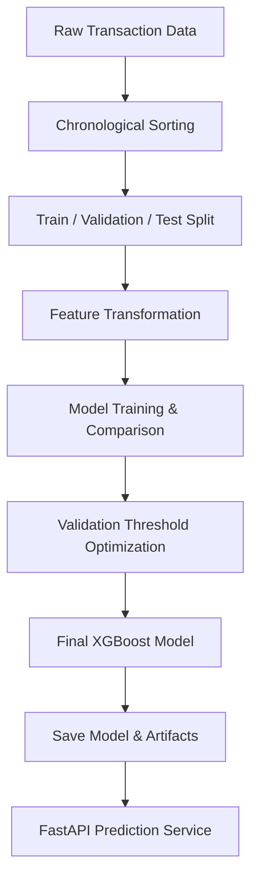
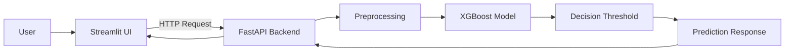
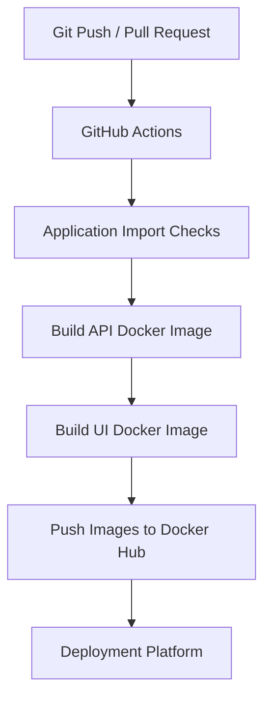
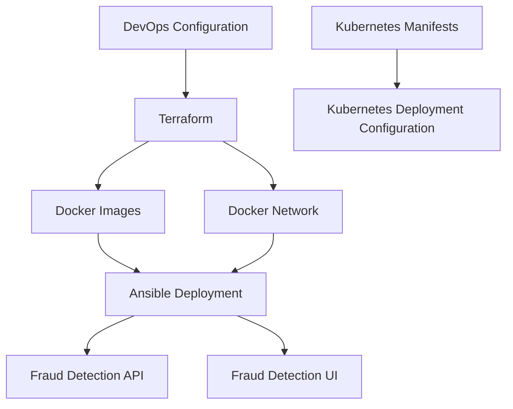
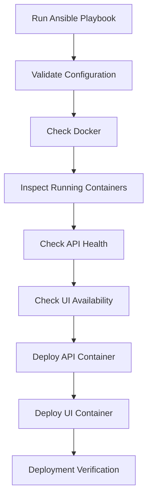

# 💳 Credit Card Fraud Detection — End-to-End ML & MLOps System

<p align="center">
  
  
  
  
  
  
  
  
  
  
  
  
</p>

<p align="center">
  <b>Fraud detection built around a real operating constraint: catch as much fraud as possible without flooding reviewers with false alarms.</b>
</p>

---

## 🚀 Live Demo

👉 **[Try the Credit Card Fraud Detection WebApp](https://fraud-detection-ui-yyA6.onrender.com)**

---

## 📌 Table of Contents

1. [Overview](#1-overview)
2. [Business Problem](#2-business-problem)
3. [Approach & Methodology](#3-approach--methodology)
4. [Final Model & Results](#4-final-model--results)
5. [Model Comparison & Experiments](#5-model-comparison--experiments)
6. [Key Findings](#6-key-findings)
7. [Application Architecture](#7-application-architecture)
8. [MLOps & CI/CD Pipeline](#8-mlops--cicd-pipeline)
9. [DevOps & Infrastructure Automation](#9-devops--infrastructure-automation)
10. [Run Locally](#10-run-locally)
11. [Docker Deployment](#11-docker-deployment)
12. [Kubernetes Configuration](#12-kubernetes-configuration)
13. [API Reference](#13-api-reference)
14. [Limitations & Future Work](#14-limitations--future-work)
15. [Author](#15-author)

---

## 1. Overview

This project implements an end-to-end credit card fraud detection system that combines machine learning, model experimentation, API development, containerization, deployment automation, and infrastructure management.

Given a transaction, the system returns:

- Fraud probability
- Decision threshold
- Binary prediction
- Prediction label — `Fraud` or `Legitimate`

### Dataset

- **Source:** [Kaggle Credit Card Fraud Detection Dataset](https://www.kaggle.com/datasets/saurabhbadole/credit-card-dataset)
- **Transactions:** 284,807
- **Features:** 30
- **Fraud cases:** 492
- **Fraud proportion:** Approximately 0.17%

### Technology Stack

| Category | Technology |
|---|---|
| Programming | Python |
| Data processing | Pandas, NumPy |
| Machine learning | XGBoost, Scikit-learn |
| Deep learning experiments | TensorFlow |
| Model tracking | MLflow |
| Backend API | FastAPI |
| Frontend | Streamlit |
| Containerization | Docker |
| CI/CD | GitHub Actions |
| Infrastructure provisioning | Terraform |
| Configuration management | Ansible |
| Container orchestration configuration | Kubernetes |
| Deployment platform | Render |
| Version control | Git, GitHub |

---

## 2. Business Problem

Credit card fraud detection is a highly imbalanced classification problem.

A system that simply maximizes accuracy can classify nearly every transaction as legitimate and still achieve extremely high accuracy while failing to identify fraud.

The real challenge is balancing:

- **Fraud detection:** Catch as many fraudulent transactions as possible.
- **False positives:** Avoid incorrectly flagging legitimate customers.
- **Operational capacity:** Keep alerts within a manageable investigation budget.

### Project Objective

> Maximize fraud recall while maintaining no more than 10 false positives on the validation set.

Accuracy was not used as the primary model selection metric because it is misleading under extreme class imbalance.

---

## 3. Approach & Methodology

### ML Pipeline



### Data Splitting

A chronological split was used instead of a random split to better simulate real-world deployment, where future transactions must be predicted using patterns learned from past transactions.

| Dataset | Rows | Fraud Cases |
|---|---:|---:|
| Train | 198,608 | 366 |
| Validation | 42,559 | 55 |
| Test | 42,559 | 52 |

### Preprocessing

- Chronological sorting by transaction time
- `log1p` transformation on `Amount`
- `StandardScaler`
- Preprocessing fitted only on training data
- Validation used for model selection and threshold tuning
- Test data kept separate from model selection

### Model Selection Strategy

The decision threshold was selected on the validation dataset to maximize fraud recall subject to:
The threshold is stored separately from the model, allowing decision-policy changes without retraining the classifier.

---

## 4. Final Model & Results

### Selected Model: XGBoost with Early Stopping

| Parameter | Value |
|---|---|
| Model | XGBoost |
| Best iteration | 100 |
| Max depth | 6 |
| Learning rate | 0.05 |
| Random state | 42 |
| Decision threshold | 0.0913 |

### Validation Performance

| Metric | Value |
|---|---:|
| Precision | 0.857 |
| Recall | 0.873 |
| F1-score | 0.865 |
| PR-AUC | 0.885 |
| False Positives | 8 |
| False Negatives | 7 |

### Test Performance

| Metric | Value |
|---|---:|
| Precision | **0.765** |
| Recall | **0.750** |
| F1-score | **0.757** |
| PR-AUC | **0.762** |
| False Positives | 12 |
| False Negatives | 13 |

> The test results represent the more realistic estimate of performance on unseen future data. The validation dataset was used for early stopping and threshold selection, so some performance degradation on the test set is expected.

---

## 5. Model Comparison & Experiments

Models were compared at the validation operating point under the false-positive constraint.

### Validation Model Comparison

| Model | PR-AUC | Recall | FP | Training Time |
|---|---:|---:|---:|---:|
| **XGBoost — Early Stopping** | **0.885** | **0.873** | 8 | **6.3 s** |
| XGBoost + Neural Network Blend | 0.883 | 0.855 | 10 | — |
| XGBoost / RF / CatBoost Ensemble | 0.876 | 0.818 | 3 | — |
| Neural Network — Focal Loss | 0.861 | 0.782 | 6 | 21.9 s |
| H2O AutoML — XRT | 0.854 | 0.818 | 7 | 6 min 20 s |
| XGBoost + SMOTE | 0.854 | 0.782 | 7 | — |
| Neural Network — Class Weights | 0.852 | 0.782 | 4 | 18.7 s |
| XGBoost + Undersampling | 0.841 | 0.782 | 10 | — |
| Autoencoder | — | 0.000 | 10 | — |

### Test Set Neural Network Comparison

Thresholds were fixed on validation and evaluated on the test set for comparison.

| Model | Precision | Recall | F1 | PR-AUC | FP | FN |
|---|---:|---:|---:|---:|---:|---:|
| XGBoost (Selected) | 0.765 | 0.750 | 0.757 | 0.762 | 12 | 13 |
| Neural Network (Focal Loss) | 0.867 | 0.750 | 0.804 | 0.759 | 6 | 13 |
| Neural Network (Class Weights) | 0.837 | 0.692 | 0.758 | 0.769 | 7 | 16 |

---

## 6. Key Findings

- **XGBoost was selected using a predefined validation criterion:** It detected 48 of 55 fraud cases, compared with 43 for both neural network approaches, while training approximately three times faster.
- **Neural networks remained competitive:** The focal-loss network achieved the same test recall as XGBoost with fewer false positives. However, the small test fraud count makes these differences uncertain.
- **Resampling and blending did not improve the selected operating point:** SMOTE, undersampling, blending, and ensemble experiments did not outperform the final XGBoost selection under the project's selection rule.
- **The autoencoder failed to detect fraud within the evaluated false-positive budget:** It detected 0 of 55 validation fraud cases.
- **Data drift was observed:** PSI exceeded 0.25 for `Time`, `V1`, `V3`, `V28`, and `V11`.
- **The most important model features showed comparatively less shift:** `V10` and `V14`.
- **Neural network experiments were not fully reproducible:** TensorFlow random seeds were not fixed, and results varied between notebook runs. XGBoost results were consistent.

---

## 7. Application Architecture

The application separates the user interface, API, preprocessing, and inference logic.



### Components

| Component | Responsibility |
|---|---|
| Streamlit | User interface for transaction input and fraud prediction |
| FastAPI | REST API and model-serving layer |
| Scaler | Feature transformation |
| XGBoost | Fraud probability prediction |
| Threshold | Converts probability into a final classification |
| Docker | Packages application components into containers |

### Model Artifacts

Stored under `models/`:

- `final_fraud_xgboost_model.json`
- `final_fraud_scaler.pkl`
- `final_fraud_threshold.pkl`

The final model is stored in native XGBoost JSON format because the pickle model encountered cross-environment loading problems.

---

## 8. MLOps & CI/CD Pipeline

### Experiment Tracking

MLflow is used to track model experiments under:

**Experiment:** `Credit Card Fraud Detection`

The final model is registered as:

**Model:** `CreditCardFraudXGBoost`  
**Version:** `1`

Experimentation included model comparison, metric tracking, hyperparameter evaluation, and model selection.

### CI/CD Workflow

GitHub Actions automates the application build process when changes are pushed to the repository or when pull requests target `main`.



### CI/CD Responsibilities

- Application import checks
- API image build
- UI image build
- Docker image publishing
- Repository-based workflow execution

### Docker Hub Images

| Component | Image |
|---|---|
| API | `kashish1303/fraud-detection-api` |
| UI | `kashish1303/fraud-detection-ui` |

GitHub Actions uses repository secrets:

- `DOCKERHUB_USERNAME`
- `DOCKERHUB_TOKEN`

**Deployment note:** Render redeployments are currently manual. A fully automated deployment trigger is not yet configured.

---

## 9. DevOps & Infrastructure Automation

The project extends beyond model development and application containerization into infrastructure provisioning and deployment automation.

### DevOps Stack

| Tool | Role | Implemented Tasks |
|---|---|---|
| **Docker** | Containerization | API and UI packaged as containers |
| **Terraform** | Infrastructure provisioning | Docker image management and network provisioning |
| **Ansible** | Configuration management & deployment | Configuration validation, Docker verification, health checks, container deployment |
| **Kubernetes** | Container orchestration configuration | Deployment and service configuration maintained in the repository |
| **GitHub Actions** | CI automation | Import checks, image builds, image publishing |

### Infrastructure Automation Architecture



### Terraform — Infrastructure Provisioning

Terraform is used to manage Docker infrastructure resources.

**Responsibilities:**

- Manage Docker images
- Provision and manage the application Docker network
- Maintain infrastructure state
- Enable repeatable infrastructure configuration

The Terraform configuration was separated from application-container management during the Terraform-to-Ansible handoff.

### Ansible — Configuration & Deployment Automation

Ansible automates the verification and deployment of the application containers.

**Implemented tasks:**

- Validate project configuration
- Verify Docker availability and version
- Check running containers
- Perform API health checks
- Verify frontend accessibility
- Validate API health status
- Deploy the Fraud Detection API container
- Deploy the Streamlit UI container
- Configure ports, images, commands, networks, and restart policies through variables
- Support repeatable execution through idempotent deployment tasks

### Ansible Deployment Flow



### Ansible Configuration

The deployment configuration is centralized in `vars.yml`, including:

- Container names
- Docker images
- API and UI ports
- Docker network
- Application commands
- Restart policies
- Working directory

The playbook was tested using both Ansible check mode and actual execution.

### Idempotency & Verification

Repeated playbook execution resulted in:

```text
changed=0
failed=0
unreachable=0
```

This confirms that the playbook recognizes the existing desired state and does not unnecessarily recreate or modify containers.

The API health endpoint and frontend accessibility checks were both verified successfully.

### Kubernetes

Kubernetes deployment configuration is maintained separately in the repository under:

```text
devops/
├── ansible/
├── kubernetes/
└── terraform/
```

Kubernetes configuration provides the next orchestration layer for containerized deployment. The Kubernetes configuration is maintained as a separate deployment setup and is not currently part of the verified Terraform–Ansible deployment workflow.

---

## 10. Run Locally

### Clone the Repository

```bash
git clone https://github.com/KashishPundir/CreditCard-Fraud-Detection.git

cd CreditCard-Fraud-Detection
```

### Install Dependencies

```bash
pip install -r requirements.txt
```

### Run the API

```bash
uvicorn app:app --port 8000
```

API documentation:

```text
http://localhost:8000/docs
```

### Run the UI

```bash
streamlit run streamlit_app.py
```

Frontend:

```text
http://localhost:8501
```

---

## 11. Docker Deployment

### Pull Images

```bash
docker compose pull
```

### Start Services

```bash
docker compose up -d
```

### Access the Application

```text
http://127.0.0.1:8501
```

### Running Containers

| Service | Port |
|---|---:|
| Fraud Detection API | 8000 |
| Streamlit UI | 8501 |

---

## 12. Kubernetes Configuration

Kubernetes deployment configuration is maintained under the `devops/kubernetes/` directory.

The configuration represents the container orchestration layer for deploying the application components through Kubernetes resources.

```text
devops/
├── ansible/
│   ├── inventory.ini
│   ├── playbook.yml
│   └── vars.yml
├── kubernetes/
│   └── deployment and service manifests
└── terraform/
    └── main.tf
```

The Kubernetes configuration is maintained separately from the current Docker-based Terraform and Ansible workflow.

---

## 13. API Reference

| Endpoint | Method | Description |
|---|---|---|
| `/health` | GET | API and model health status |
| `/predict` | POST | Fraud prediction for a transaction |
| `/docs` | GET | Interactive Swagger API documentation |

### Prediction Input

The API accepts transaction features:

- `Time`
- `V1`–`V28`
- `Amount`

### Example Response

```json
{
  "fraud_probability": 0.9572,
  "threshold": 0.0913,
  "prediction": 1,
  "prediction_label": "Fraud"
}
```

---

## 14. Limitations & Future Work

### Current Limitations

- Only 52 fraudulent transactions are available in the test set, resulting in noisy metrics.
- Test performance is lower than validation performance.
- Distribution drift exists between training and test data.
- Neural network results are based on unseeded experiments.
- The system is a demonstration-scale project.
- Authentication is not implemented.
- Load testing has not been conducted.
- Automated API testing is not yet integrated into CI.
- Render redeployment is manual.
- Kubernetes configuration is not integrated into the current automated deployment workflow.

### Future Improvements

- Reproducible neural network experiments using fixed seeds and multi-run evaluation.
- Automated API tests in GitHub Actions.
- Automated deployment triggers.
- Model and feature drift monitoring.
- Kubernetes deployment validation and orchestration.
- Authentication and security improvements.
- Load and stress testing.
- Model retraining and monitoring workflow.

---

## 15. Author

**Kashish Pundir**

GitHub: [KashishPundir](https://github.com/KashishPundir)

---

<p align="center">
  <i>Fraud detection is about trade-offs, not accuracy. This project makes that trade-off explicit—from model evaluation to deployment and infrastructure automation.</i>
</p>

<p align="center">
  ⭐ If you found this project useful, consider starring the repository.
</p>
